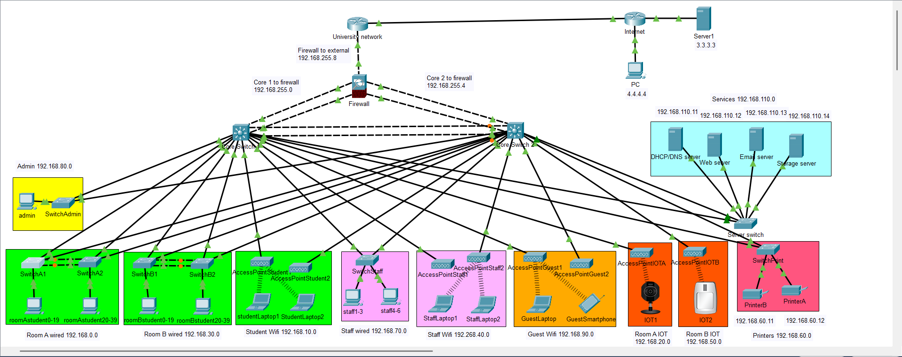
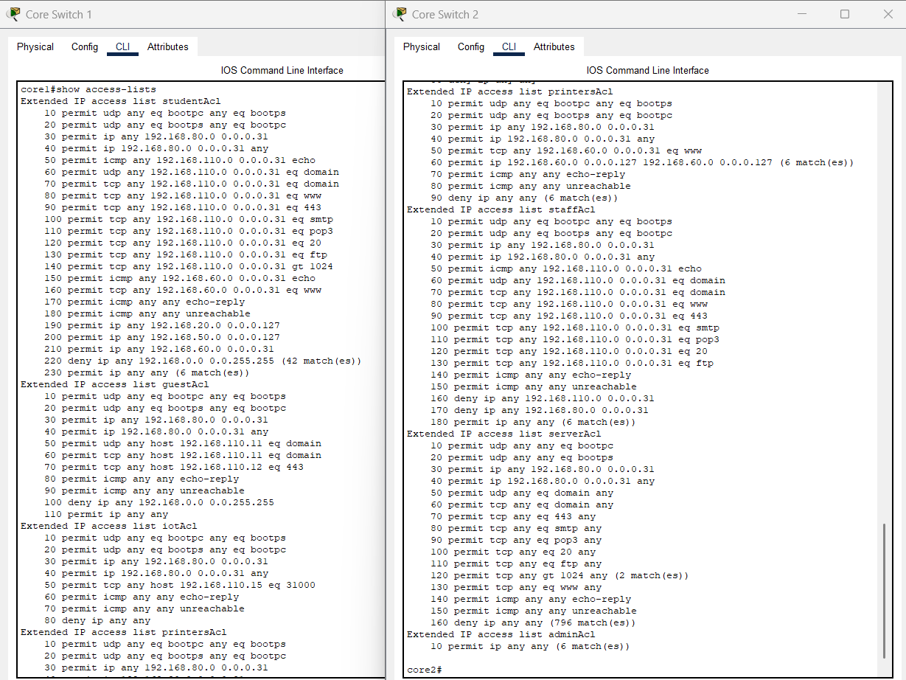
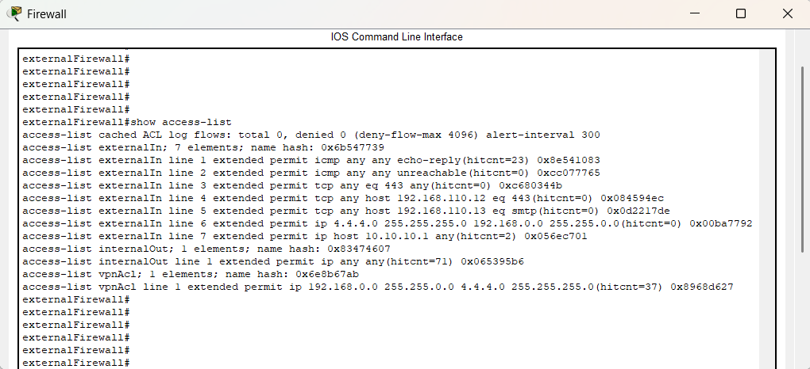
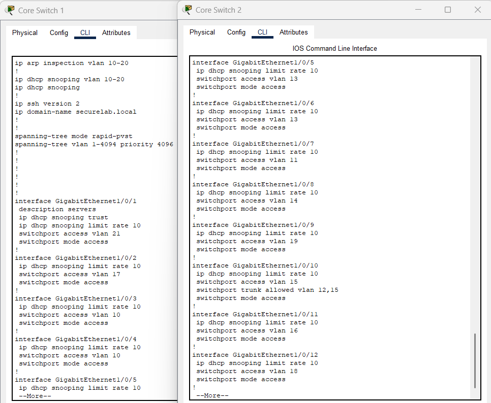
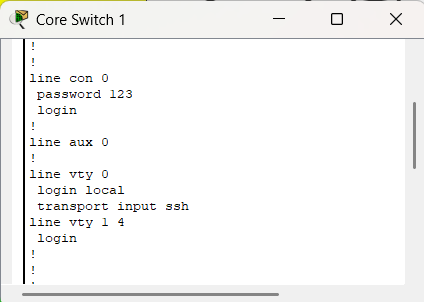
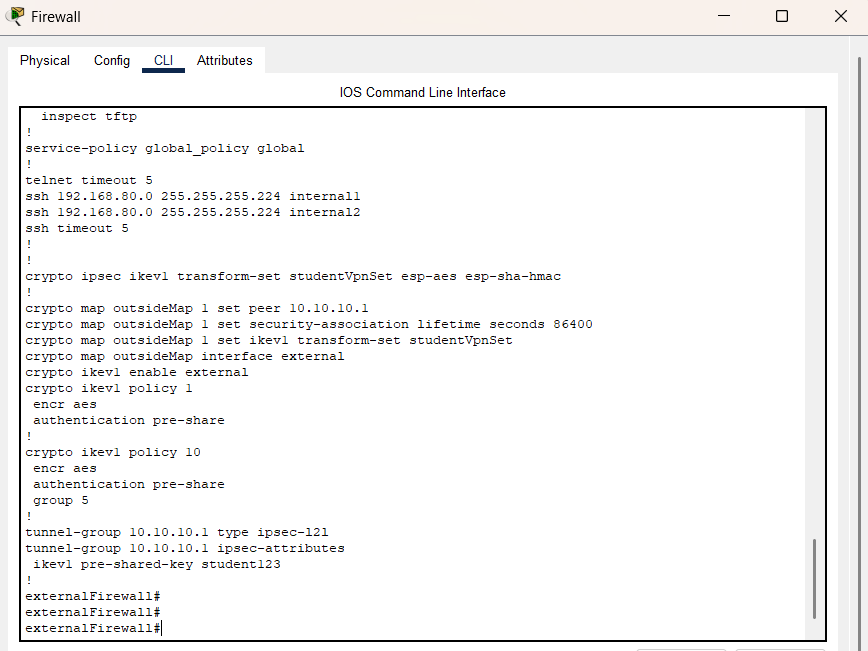
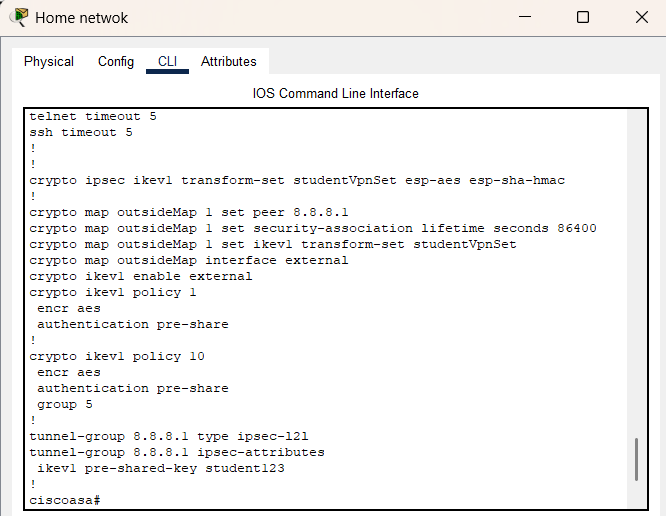
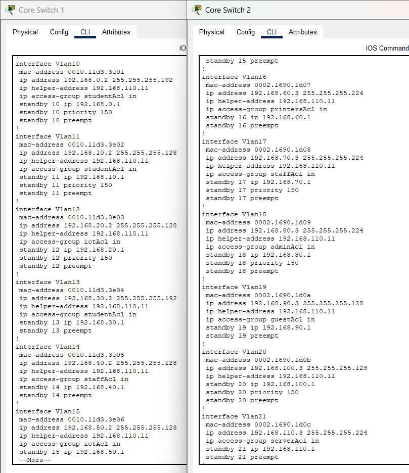
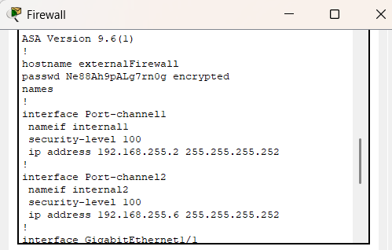

# Secure Network Design - Cisco Packet Tracer

A sandboxed cyber-security lab network for ~400 devices across two classrooms, designed as coursework for my *Secure Communication Networks* module (Cardiff University).

**Stack:** Cisco IOS (multilayer switches, HSRP, EtherChannel), ASA firewall (ACLs, IPsec), DHCP snooping + Dynamic ARP Inspection, 13 segmented subnets.

## Problem statement

Design a standalone network for cyber-security students, isolated from the university WAN: student PCs (wired + Wi-Fi), staff, guest access, IoT/OT devices for testing, printers, and local services (HTTPS, DNS/DHCP, email, FTP) - with least-privilege access between all trust zones.

## Threat model and control

| Threat | Control implemented |
|---|---|
| Untrusted external inbound (scanning, brute force, malware delivery) | ASA ACL: inbound limited to web/email service ports; explicit deny-all |
| Lateral movement between trust zones | 13 VLANs by trust level + ACL matrix |
| Rogue DHCP server / MITM | DHCP snooping - only the trusted server port may send DHCP responses |
| ARP poisoning | Dynamic ARP Inspection against the snooping IP-MAC binding table |
| DHCP starvation | Rate limits on each core SVI |
| Eavesdropping on remote access | IPsec site-to-site tunnel between ASAs simulates a student VPN (see limitations) |
| Core single point of failure | HSRP active/standby multilayer core + dual-homed access switches |
| Uplink failure / congestion on firewall | EtherChannel bundled logical links |
| Unauthorised device administration | SSH management restricted to admin VLAN; physical controls (key-card room, CCTV) |

## Design decisions

- **Collapsed core, not a router mesh.** Inter-VLAN routing on two redundant multilayer switches: fewer devices, hardware-rate routing, no single point of failure. A per-subnet router design would cost more and be harder to maintain at this scale.
- **Segmentation by trust.** Trust lives in the ACL group, students and IoT are split per room only to bound broadcast domains.
- **Consistent addressing to keep ops easy:** `.1` always the gateway, `.2-.10` reserved for network devices, end devices from `.11`.
- **Subnet sizing with growth headroom:** /26 for 40-seat wired rooms, /25 for Wi-Fi (2+ devices per person, special event load), /27 for small zones, /30 for point-to-point.

## Subnetting scheme

| Description | End devices | Network | Mask | Usable | DHCP pool | VLAN | ACL group |
|--|--|--|--|--|--|--|--|
| Room A wired | 40 | 192.168.0.0/26 | 255.255.255.192 | 62 | .11-.50 | 10 | student |
| Student Wi-Fi | 100 | 192.168.10.0/25 | 255.255.255.128 | 126 | .11-.110 | 11 | student |
| Room A IoT | 100 | 192.168.20.0/25 | 255.255.255.128 | 126 | .11-.110 | 12 | IoT |
| Room B wired | 40 | 192.168.30.0/26 | 255.255.255.192 | 62 | .11-.50 | 13 | student |
| Staff Wi-Fi | 100 | 192.168.40.0/25 | 255.255.255.128 | 126 | .11-.110 | 14 | staff |
| Room B IoT | 100 | 192.168.50.0/25 | 255.255.255.128 | 126 | .11-.110 | 15 | IoT |
| Printers | 2+ | 192.168.60.0/27 | 255.255.255.224 | 30 | static | 16 | printer |
| Staff wired | 6+ | 192.168.70.0/27 | 255.255.255.224 | 30 | static | 17 | staff |
| Admin | 1+ | 192.168.80.0/27 | 255.255.255.224 | 30 | static | 18 | admin |
| Guest Wi-Fi | 100 | 192.168.90.0/25 | 255.255.255.128 | 126 | .11-.110 | 19 | guest |
| Services | 4+ | 192.168.110.0/27 | 255.255.255.224 | 30 | static | 21 | server |
| Core 1 to firewall | 2 | 192.168.255.0/30 | 255.255.255.252 | 2 | static | 100 | internal |
| Core 2 to firewall | 2 | 192.168.255.4/30 | 255.255.255.252 | 2 | static | 101 | internal |

## Traffic separation by trust level

- **Students and staff** need access to all lab services, the internet, printers and IoT devices.
- **Staff** additionally need to communicate with student and guest devices for supervision.
- **IoT, printers and servers** are restricted from initiating communication with other subnets and may only respond using essential services.
- **Guests** are restricted to web/DHCP services and the internet only.
- **Admins** have unrestricted access across the network.

## Availability and performance

- **HSRP** virtual gateway per VLAN across the core pair; failover in seconds on dropped hellos; no endpoint reconfiguration.
- **EtherChannel** on ASA internal links - redundancy plus bandwidth.
- Hardware inter-VLAN routing for latency/throughput.
- Metrics I would verify in a live deployment: failover time, packet loss/latency under load, throughput, uptime.

## Known limitations

- **IPsec encryption is not functioning in practice:** The site-to-site VPN between the two ASAs was configured and is in place to demonstrate the intended secure remote-access design, but I didn't get the tunnel to successfully encrypt traffic in Packet Tracer.
- **No AAA:** To further protect confidentiality and integrity, a central *Authentication, Authorization and Accounting* server should be implemented. This would ensure only authenticated users can access the network and would provide a log of administrative activity. To avoid compromising availability, a backup AAA server would be needed to remove the single point of failure.

## Run it

Open `simulation.pkt` in Cisco Packet Tracer 8.x; device credentials and configs are inside the topology.

See [coursework_submission.pdf](coursework_submission.pdf) for the original submission document.

Configurations

*Core switch ACL:*

*ASA firewall ACL:*

*DHCP snooping + Dynamic ARP Inspection:*

*Management hardening:*

*Firewall SSH + IPsec:*

*Remote peer IPsec:*

*Core switch SVIs shared using HSRP*

*EtherChannel interfaces on firewall*

